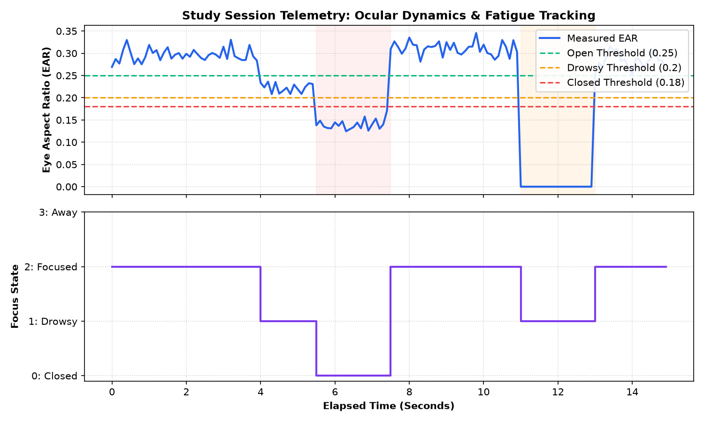

<div align="center">

# 👁️ Smart Study Buddy & Edge Drowsiness Monitor

**An Edge AI & IoT Computer Vision System Combining 468-Point MediaPipe FaceMesh Tracking, Mathematical Eye Aspect Ratio (EAR) Telemetry, and ESP32-CAM Embedded Hardware Actuation.**

[](https://www.python.org/)
[](https://developers.google.com/mediapipe)
[](https://opencv.org/)
[](https://www.espressif.com/)
[](https://platformio.org/)
[](LICENSE)
[]()

[Features](#-key-features) • [Architecture](#-system-architecture) • [Ocular Mathematics (EAR)](#-ocular-biometrics--ear-mathematics) • [Hardware Wiring](#-hardware-architecture--circuit-schematic) • [Quickstart](#-quickstart-guide) • [CV Bullet Points](#-cv--resume-bullet-points)

</div>

---

## 📌 Project Overview

**Smart Study Buddy** is a cyber-physical Computer Vision and IoT platform designed to combat cognitive fatigue, micro-sleeps, and attention drift during prolonged study or driving sessions. 

The system operates across two tightly coupled subsystems:
1. **Host Computer Vision Engine (Python + MediaPipe + OpenCV)**: Tracks 468 facial 3D landmarks in real time, computes mathematical Eye Aspect Ratio (EAR) apertures, detects blinks, tracks fatigue velocity, renders a Heads-Up Display (HUD), and logs session telemetry.
2. **Edge Hardware Station (ESP32-CAM + C++ Firmware)**: A dedicated desk-mounted microcontroller featuring an OV2640 camera, a 16x2 I2C LCD status screen, an active audio buzzer, an alert LED, and a physical study session push button communicating bidirectionally over UART/Serial.

---

## ✨ Key Features

- **Sub-Millisecond Ocular Geometry**: Uses 6-point Euclidean landmark contours for left and right eyes, calculating the Eye Aspect Ratio (EAR) to accurately distinguish involuntary natural blinks (<300ms) from drowsy micro-sleeps (>1.8s).
- **Edge Microcontroller Integration**: Synchronizes state bytes over UART at 115,200 baud to drive an ESP32-CAM, alerting users via a physical 2 kHz buzzer and high-intensity alert LED when fatigue is detected.
- **Dynamic 16x2 I2C LCD Display**: Real-time hardware feedback displaying operational states: `Status: Focused`, `Status: Drowsy`, `ALERT: WAKE UP!`, or `AWAY: RETURN!`.
- **Comprehensive Session Analytics**: Real-time calculation of rolling Blinks Per Minute (BPM), cumulative focus percentage, micro-sleep event frequency, and JSON session exports.
- **Universal Multi-Source Streaming**: Seamlessly streams frames from USB Webcams, ESP32-CAM MJPEG HTTP streams, offline video files, or a built-in synthetic procedural simulator for headless CI/CD.
- **Hardware-Agnostic Standalone Mode**: Automatically detects if physical serial hardware is disconnected, gracefully activating standalone Computer Vision mode without crashing.

---

## 🏛️ System Architecture

```mermaid
flowchart TD
    subgraph EdgeHardware [ESP32-CAM Edge Station]
        Cam[OV2640 Camera Sensor] -->|JPEG Stream over WiFi/Serial| Streamer
        Btn[Physical Start/Stop Button] -->|UART 'SESSION_START'| SerialIn
        Actuator[Buzzer & Red LED] <--|UART Focus State '0'-'3'| SerialOut
        LCD[I2C 16x2 LCD Display] <--|Text Status Updates| Actuator
    end

    subgraph HostPipeline [Host Computer Vision & Analytics Pipeline]
        Streamer[Frame Streamer<br/>Webcam / ESP32 / Video / Synthetic] --> Detector[FaceMesh Landmark Detector<br/>468 3D Landmarks]
        
        Detector --> EARCalc[EAR Calculation Engine<br/>Euclidean Aperture Ratio]
        
        EARCalc --> Tracker[Session Analytics & State Machine<br/>Blink Counter, BPM, Fatigue Timer]
        
        Tracker --> SerialOut[Serial Controller<br/>115200 Baud]
        SerialIn --> Tracker
        
        Tracker --> HUDRenderer[Real-Time HUD Renderer<br/>Contour Polygons, EAR Meters, Alerts]
        HUDRenderer --> Screen([OpenCV Video Display])
        Tracker --> Report([Session JSON Telemetry Report])
    end
```

---

## 📐 Ocular Biometrics & EAR Mathematics

The **Eye Aspect Ratio (EAR)** formulation (Soukupová and Čech) measures the ratio of vertical eye aperture to horizontal eye length.

```
       P2        P3
        +--------+
       /          \
  P1  +            +  P4   (Horizontal Length)
       \          /
        +--------+
       P6        P5
```

$$\text{EAR} = \frac{||P_2 - P_6|| + ||P_3 - P_5||}{2 \times ||P_1 - P_4||}$$

### MediaPipe Landmark Mapping
- **Left Eye Indices**: `[33, 160, 158, 133, 153, 144]`
- **Right Eye Indices**: `[362, 385, 387, 263, 373, 380]`

### State Machine Classification Rules

| State Code | Categorization | EAR Threshold | Condition / Action |
|:---:|---|---|---|
| **`2`** | **FOCUSED** | $\text{EAR} \ge 0.25$ | Eyes open and alert. LED: OFF, Buzzer: OFF. |
| **`1`** | **DROWSY** | $0.18 \le \text{EAR} < 0.25$ | Partial eyelid closure. Yellow HUD warning. |
| **`0`** | **EYES CLOSED** | $\text{EAR} < 0.18$ | Continuous duration $\ge 1.8\text{s}$. **ALARM: 2 kHz Buzzer + Red LED ON**. |
| **`3`** | **ABSENT / AWAY** | No Face Detected | Continuous absence $\ge 15.0\text{s}$. **ALARM: 1.2 kHz Buzzer + Red LED ON**. |

---

## 📊 Session Telemetry Benchmark

The system continuously measures ocular dynamics and state transitions throughout a session:

<div align="center">
  
</div>

---

## 🔌 Hardware Architecture & Circuit Schematic

| Component | Pin / Bus | ESP32-CAM Pin | Description |
|---|---|---|---|
| **OV2640 Camera** | D0-D7, XCLK, PCLK, HREF, VSYNC | Dedicated Camera Bus | Video capture up to 30 FPS |
| **16x2 LCD (I2C Backpack)** | SDA | `GPIO 1` | Displays session time & focus text |
| **16x2 LCD (I2C Backpack)** | SCL | `GPIO 2` | I2C Clock line |
| **Active Audio Buzzer** | Signal (+) | `GPIO 41` | Piezoelectric alarm tone generator |
| **High-Intensity Alert LED** | Anode (+) via 220Ω | `GPIO 40` | Visual fatigue warning indicator |
| **Session Push Button** | Signal (Active LOW) | `GPIO 19` | Debounced hardware start/pause toggle |
| **Host PC Connection** | UART TX/RX | TX0 / RX0 | Serial link at 115,200 baud |

---

## 📂 Project Structure

```
smart-study-buddy-iot/
├── .github/
│   └── workflows/
│       └── ci.yml                     # Multi-version test and headless simulation CI
├── src/                               # Core Python source packages
│   ├── __init__.py
│   ├── config.py                      # Global thresholds, state enums, serial settings
│   ├── vision/
│   │   ├── __init__.py
│   │   ├── ear_calculator.py          # Pure Euclidean mathematical EAR calculation
│   │   ├── face_mesh_detector.py      # Universal MediaPipe FaceMesh/FaceLandmarker wrapper
│   │   └── frame_streamer.py          # Unified frame streamer (Webcam, ESP32, Video, Synthetic)
│   ├── hardware/
│   │   ├── __init__.py
│   │   └── serial_controller.py       # Bidirectional UART controller with mock fallback
│   ├── analytics/
│   │   ├── __init__.py
│   │   └── session_tracker.py         # Blink rate, fatigue timer, focus score engine
│   └── ui/
│       ├── __init__.py
│       └── hud_renderer.py            # Real-time HUD overlay with contour geometry & meters
├── firmware/                          # ESP32-CAM Embedded C++ Firmware
│   ├── esp32_camera_firmware.ino      # Main Arduino sketch (camera, I2C LCD, Buzzer, Button)
│   ├── board_config.h                 # Peripheral pinout definitions
│   ├── camera_pins.h                  # OV2640 camera bus pin mappings
│   └── platformio.ini                 # PlatformIO embedded build configuration
├── tests/                             # Comprehensive unit test suite (100% pass)
│   ├── __init__.py
│   ├── test_ear_calculator.py         # EAR mathematics & geometry tests
│   ├── test_session_tracker.py        # State transitions & fatigue timer tests
│   └── test_serial_controller.py      # UART communication & mock fallback tests
├── assets/                            # Visual assets and telemetry figures
│   └── session_telemetry_plot.png
├── models/                            # MediaPipe neural model assets
│   └── face_landmarker.task
├── main.py                            # Primary executable application
├── simulate_session.py                # Standalone simulation benchmark
├── requirements.txt                   # Production dependencies
├── requirements-dev.txt               # Testing dependencies
├── .gitignore                         # Exclusions for Python, cache, and firmware builds
├── LICENSE                            # MIT License
└── README.md                          # Comprehensive documentation
```

---

## 🚀 Quickstart Guide

### 1. Installation

```bash
# Clone the repository
git clone https://github.com/your-username/smart-study-buddy-iot.git
cd smart-study-buddy-iot

# Create and activate virtual environment
python -m venv venv

# On Windows:
venv\Scripts\activate
# On Linux / macOS:
source venv/bin/activate

# Install dependencies
pip install -r requirements.txt
```

### 2. Run Modes

#### A. Standard Mode with Local Webcam
```bash
python main.py --source webcam
```

#### B. Network Mode with ESP32-CAM Stream
```bash
python main.py --source esp32 --url http://192.168.3.23/ --port COM4
```

#### C. Standalone Simulation Mode (No Physical Camera or Hardware Needed)
```bash
python main.py --source synthetic --no_serial
```

#### D. Run 60-Second Telemetry Simulation & Generate Plot
```bash
python simulate_session.py
```

### 3. Keyboard Hotkeys
- **`[S]`**: Toggle study session timer (Active / Paused).
- **`[R]`**: Reset session telemetry counters.
- **`[Q]`** or **`[ESC]`**: Exit application and export `session_report.json`.

### 4. Run Test Suite
```bash
python -m unittest discover tests -v
```

---

## 🛠️ Flashing the ESP32-CAM Firmware

### Using PlatformIO (Recommended)
```bash
cd firmware
pio run -t upload
```

### Using Arduino IDE
1. Open `firmware/esp32_camera_firmware.ino` in Arduino IDE.
2. Select Board: **AI Thinker ESP32-CAM**.
3. Install Library: **LiquidCrystal_I2C** via Library Manager.
4. Set Upload Speed: `921600`, Flash Frequency: `80MHz`.
5. Connect GPIO 0 to GND, click Upload, then disconnect GPIO 0 and reset.

---

## 💼 CV / Resume Bullet Points

### For Computer Vision / Machine Learning Roles:
> - **Edge AI Fatigue & Drowsiness Monitor**: Engineered a real-time computer vision system tracking 468 facial landmarks via Google MediaPipe FaceMesh to calculate Eye Aspect Ratio (EAR) biometrics, detecting micro-sleeps (>1.8s) and involuntary blink rates.
> - **Cyber-Physical IoT Integration**: Architected a dual-subsystem edge pipeline connecting Python computer vision analytics to an ESP32-CAM microcontroller over bidirectional UART, triggering physical buzzer alarms, alert LEDs, and dynamic I2C LCD screen updates.
> - **Telemetry & Resilient Engineering**: Built multi-source frame ingestion supporting Webcams, ESP32 HTTP streams, and procedural simulators, backed by a 13-test automated CI suite and session analytics exports.

### For Embedded Systems / IoT Roles:
> - **ESP32-CAM Smart Study Assistant**: Developed C++ firmware utilizing FreeRTOS, OV2640 camera drivers, I2C 16x2 LCD displays, and debounced hardware push buttons to establish a low-latency smart desk assistant.
> - **Bidirectional Serial Protocol**: Implemented a reliable UART state-synchronization protocol operating at 115,200 baud, translating host computer vision ocular fatigue classifications into hardware alerts.

---

## 📜 License

Distributed under the MIT License. See [LICENSE](LICENSE) for more information.
